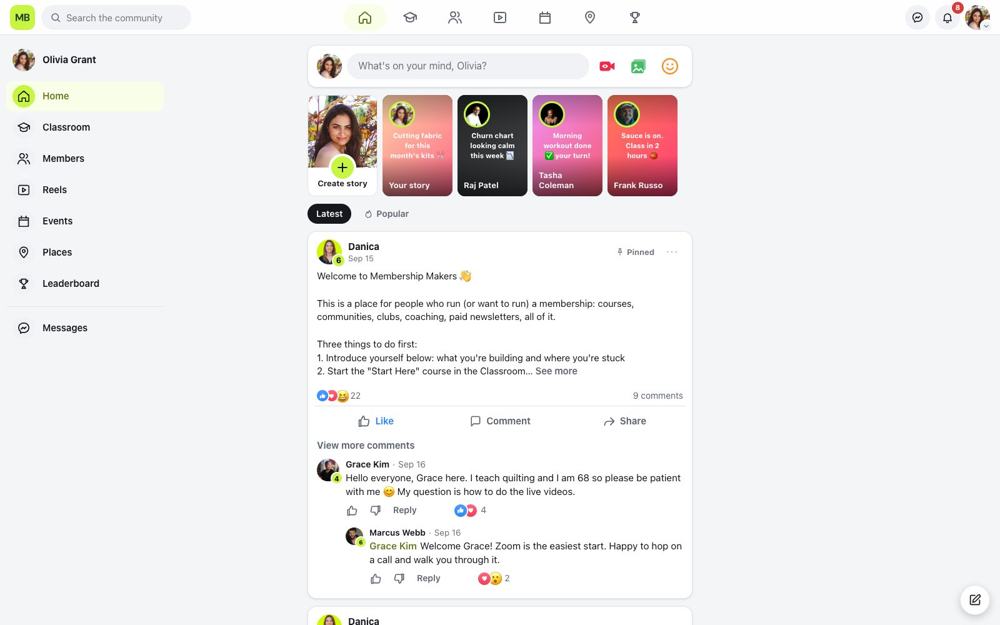
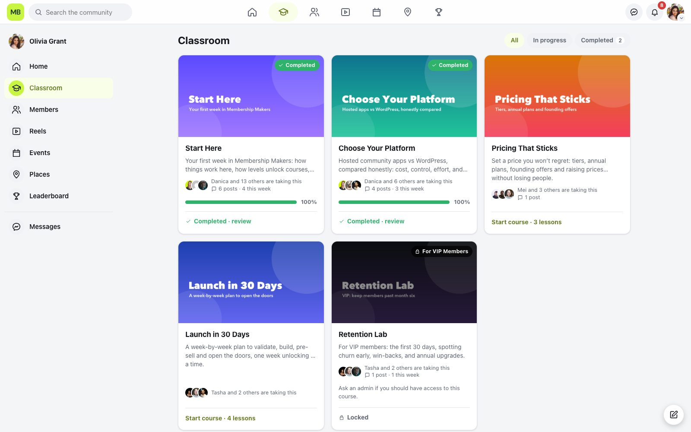
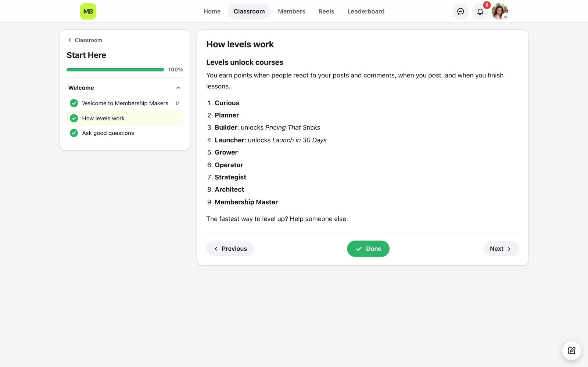
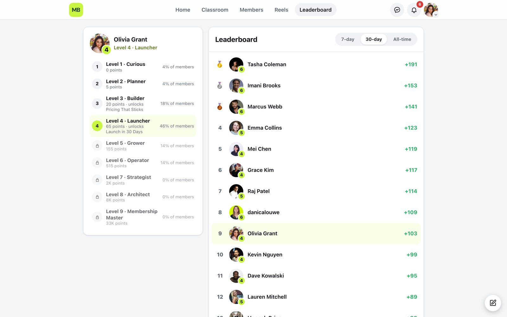
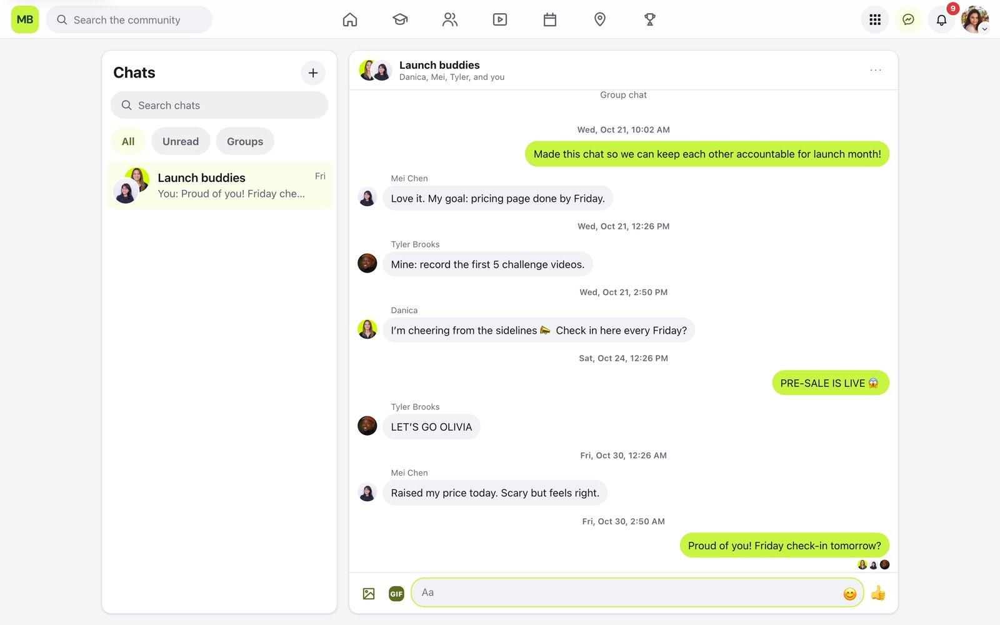
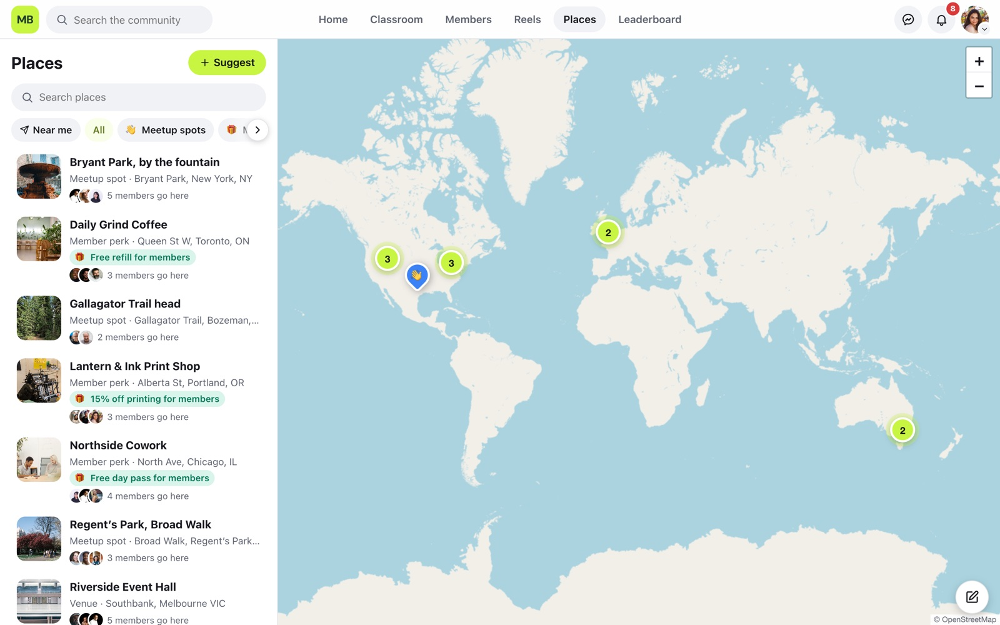
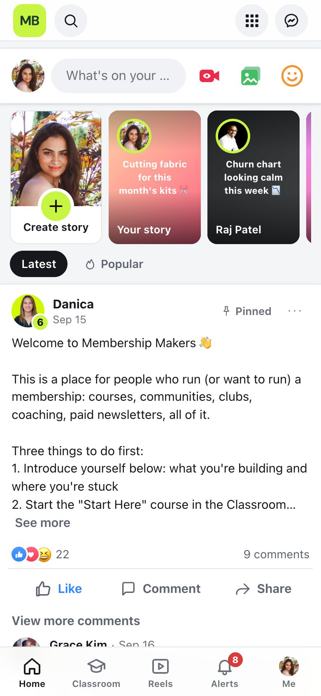
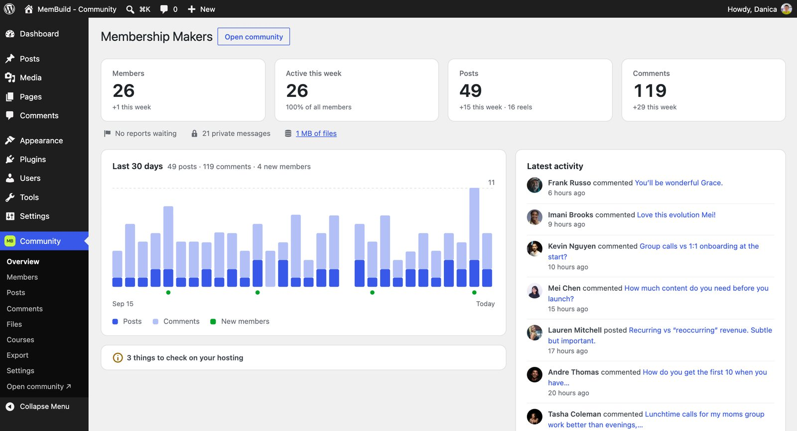

# MemBuild - Community

A free community for WordPress, as simple as Skool and as familiar as Facebook. Members get a feed, reels, stories, courses, levels and private messages, in one app at `yoursite.com/community`. Site owners run it without touching code.

**[Try the live demo →](https://demo-community.membuild.com)**

<picture><source media="(prefers-color-scheme: dark)" srcset="docs/screenshots/dark/feed.jpg"></picture>

<table>
  <tr>
    <td width="50%"><picture><source media="(prefers-color-scheme: dark)" srcset="docs/screenshots/dark/classroom.jpg"></picture></td>
    <td width="50%"><picture><source media="(prefers-color-scheme: dark)" srcset="docs/screenshots/dark/lesson.jpg"></picture></td>
  </tr>
  <tr>
    <td><picture><source media="(prefers-color-scheme: dark)" srcset="docs/screenshots/dark/leaderboard.jpg"></picture></td>
    <td><picture><source media="(prefers-color-scheme: dark)" srcset="docs/screenshots/dark/messages.jpg"></picture></td>
  </tr>
</table>

<picture><source media="(prefers-color-scheme: dark)" srcset="docs/screenshots/dark/places.jpg"></picture>
<sub>Places (optional): meetup spots, partners with a member perk, and venues, on a map.</sub>

<table>
  <tr>
    <td width="32%" valign="top"><picture><source media="(prefers-color-scheme: dark)" srcset="docs/screenshots/dark/phone.jpg"></picture></td>
    <td valign="top"><br><sub>Left: the community on a phone, installable as an app. Right: the overview in wp-admin.</sub></td>
  </tr>
</table>

## What's inside

- **Feed:** posts with photos, video and links; reactions, comments and replies; pinned posts.
- **Reels and stories:** vertical video, compressed in the browser before upload; 24-hour stories.
- **Classroom:** courses with modules and lessons, drip release, and courses unlocked by level or member group.
- **Levels and leaderboard:** points for taking part, nine levels you can rename, weekly and monthly leaderboards.
- **Messages:** one-to-one and group chats, encrypted before they're saved. Admins see counts, never the text.
- **Places (optional):** a map of meetup spots, partners with member perks, and venues. Off until you switch it on.
- **Search:** members, posts, comments, lessons and places, from one box.
- **GIFs (optional):** a GIF button with GIPHY's search in posts, comments and chats, once you add a free GIPHY key.
- **Moderation:** reports, mutes, bans and blocking.
- **Your login and sign-up pages,** in the community's colors.
- **Installable as an app** on phones, with your logo as the icon.

Everything is stored in your own WordPress database. No accounts with us and no ads. Once a week the plugin tells us it's installed (a random ID and version numbers, nothing about your site or members), and you can choose to share anonymous usage, like which features you use, to help us decide what to build. See `readme.txt` → External services.

## Install

1. Download `membuild-community-<version>.zip` from the [latest release](https://github.com/danicalouwe/membuild-community/releases/latest).
2. In WordPress, go to **Plugins → Add New → Upload Plugin**, choose the zip, then **Activate**.
3. Open **Community** in the WordPress menu, or visit `/community` on your site.

Requires WordPress 6.4 or newer and PHP 8.1 or newer, with "pretty" permalinks (any setting except Plain).

## Updates

New versions are published here as releases. Your site checks for them twice a day, and they appear in **Dashboard → Updates** like any other plugin update. The update check sends nothing about your site.

## For developers

The plugin is in `membuild-community/`. The member app (Vue 3 + Vite) is in `app/` and builds into `membuild-community/assets/build`.

Requires Docker Desktop and Node 20+.

```bash
npm install                 # local WordPress tooling (wp-env)
npm --prefix app install
npm run build               # build the app into the plugin
npm run wp:start            # WordPress at http://localhost:8891
npm run wp:cli -- rewrite structure '/%postname%/' --hard
npm test                    # end-to-end checks on the separate tests site (port 8892)
npm run zip                 # writes dist/membuild-community-<version>.zip
```

Use the project's own wp-env (`npm run wp:cli` or `./node_modules/.bin/wp-env`), not `npx wp-env`: an unrelated npm package is published under that name.

Hooks for extending it are listed in `membuild-community/readme.txt` under Developers. `tests/stress/` holds the heavier checks: a 50,000-member community, hostile uploads, multisite and popular plugins side by side.

## License

Copyright (C) 2026 Danica Louwe ([MemBuild](https://membuild.com/)). Released under GPL-2.0-or-later, see [LICENSE](LICENSE): you may use, change and share it, keeping the copyright notices and saying what you changed. The MemBuild name and logo aren't part of the license.
