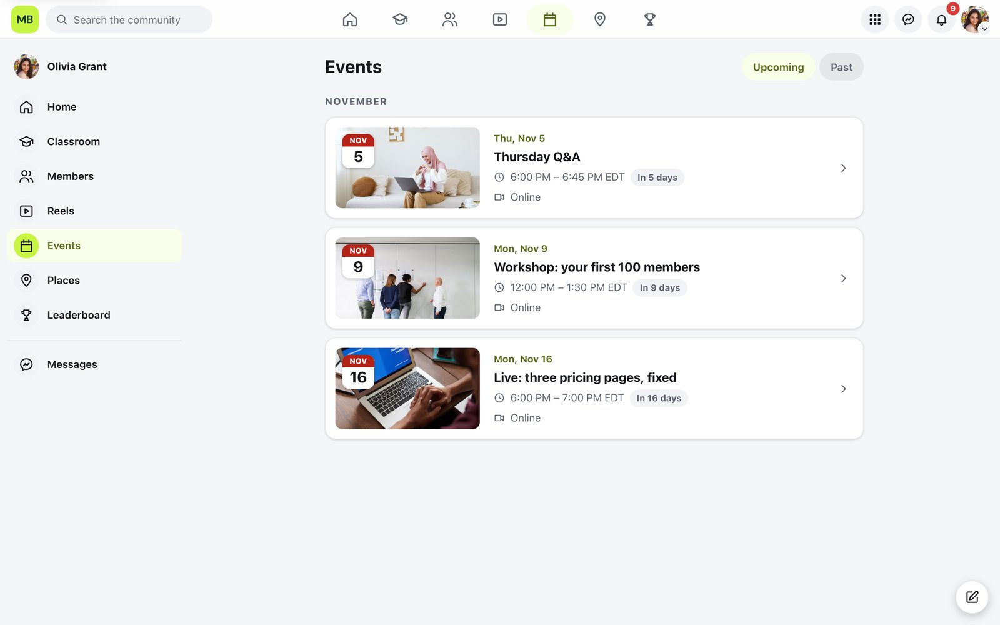
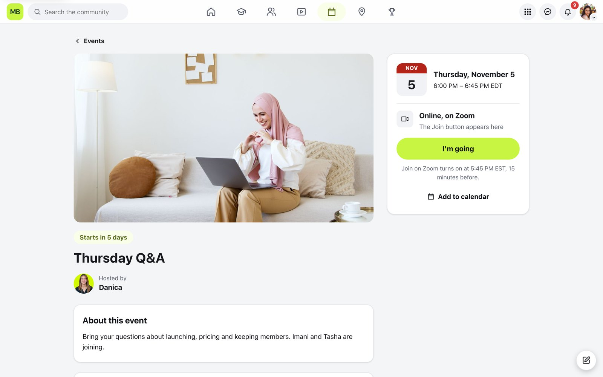
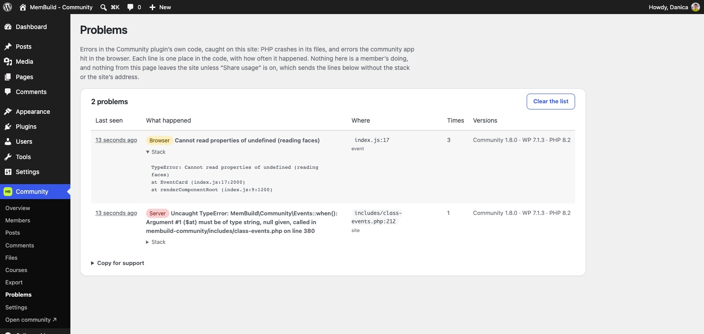

# MemBuild - Community

A free community for WordPress, as simple as Skool and as familiar as Facebook. Members get a feed, reels, stories, courses, levels and private messages, in one app at `yoursite.com/community`. Site owners run it without touching code.

**[Try the live demo →](https://demo-community.membuild.com)**


<table>
  <tr>
    <td width="50%"></td>
    <td width="50%"></td>
  </tr>
  <tr>
    <td></td>
    <td></td>
  </tr>
</table>

<table>
  <tr>
    <td width="50%"></td>
    <td width="50%"></td>
  </tr>
</table>
<sub>Events: a calendar with RSVPs, add-to-calendar, reminders, and a Join button or a live stream that plays on the page.</sub>


<sub>Places (optional): meetup spots, partners with a member perk, and venues, on a map.</sub>

<table>
  <tr>
    <td width="32%" valign="top"></td>
    <td valign="top"><br><sub>Left: the community on a phone, installable as an app. Right: the overview in wp-admin.</sub></td>
  </tr>
</table>


<sub>Problems: errors in the plugin's own code are caught on your site and listed for the admin, scrubbed of emails, links and paths. Nothing leaves the site unless you share usage, and then only the lines, never the stack.</sub>

## What's inside

- **Feed:** posts with photos, video and links; reactions, comments and replies; pinned posts; topics to sort posts by, with filters on Home.
- **Reels and stories:** vertical video, compressed in the browser before upload; 24-hour stories.
- **Events:** a calendar of live calls, Q&As and workshops with Going/Interested, add-to-calendar, reminders the day before and an hour before, and a Join button or a live stream playing on the page.
- **Classroom:** courses with modules and lessons, drip release, and courses unlocked by level or member group. Every card says where you stand, "Continue where you left off" picks up your next lesson, and each lesson has its own discussion with Helpful votes, pins and a Best answer, plus a Resources tab for every file in the course.
- **Levels and leaderboard:** points for taking part, nine levels you can rename, and a leaderboard for the week, the month and all time.
- **Messages:** one-to-one and group chats, encrypted before they're saved. Admins see counts, never the text.
- **Places (optional):** a map of meetup spots, partners with member perks, and venues. Off until you switch it on.
- **Search:** members, posts, comments, lessons and places, from one box.
- **GIFs (optional):** a GIF button with GIPHY's search in posts, comments and chats, once you add a free GIPHY key.
- **Moderation:** reports, mutes, bans and blocking.
- **Memberships (optional):** sell access to courses and groups with FluentCart; members see their plans, receipts and cancel from Billing.
- **Emails:** a welcome email, then new messages, comments on your posts and replies to yours, instantly or as a daily summary. Members choose, every email has a one-click unsubscribe, and you pick the delivery (your host, Resend or any SMTP).
- **Log in and Join pages,** led by you: your photo and one line about what members get, the next live call, and "Email me a login link" so members can log in without a password.
- **Starter website pages (optional):** Home, Pricing, About, Courses, guidelines, contact and legal pages, made from WordPress blocks you can edit, with your live courses, events and plans in them.
- **Import:** move over from BuddyBoss, BuddyPress, PeepSo or FluentCommunity (members, posts, comments, reactions, chats and points, and courses where the old platform has them; groups become topics), or add members from a spreadsheet. Check first, then undo an import if you need to.
- **Light or dark,** each member's choice, and **installable as an app** on phones, with your logo as the icon.

Everything is stored in your own WordPress database. No accounts with us and no ads. Once a week the plugin tells us it's installed (a random ID and version numbers, nothing about your site or members), and you can choose to share anonymous usage, like which features you use, to help us decide what to build. See `readme.txt` → External services.

## Install

1. Download `membuild-community-<version>.zip` from the [latest release](https://github.com/danicalouwe/membuild-community/releases/latest).
2. In WordPress, go to **Plugins → Add New → Upload Plugin**, choose the zip, then **Activate**.
3. Open **Community** in the WordPress menu, or visit `/community` on your site.

Requires WordPress 6.4 or newer and PHP 8.1 or newer, with "pretty" permalinks (any setting except Plain).

## Updates

New versions are published here as releases. Your site checks for them twice a day, and they appear in **Dashboard → Updates** like any other plugin update. The update check sends nothing about your site.

## For developers

The plugin is in `membuild-community/`. The member app (Vue 3 + Vite) is in `app/` and builds into `membuild-community/assets/build`.

Requires Docker Desktop and Node 20+.

```bash
npm install                 # local WordPress tooling (wp-env)
npm --prefix app install
npm run build               # build the app into the plugin
npm run wp:start            # WordPress at http://localhost:8891
npm run wp:cli -- rewrite structure '/%postname%/' --hard
npm test                    # end-to-end checks on the separate tests site (port 8892)
npm run zip                 # writes dist/membuild-community-<version>.zip
```

Use the project's own wp-env (`npm run wp:cli` or `./node_modules/.bin/wp-env`), not `npx wp-env`: an unrelated npm package is published under that name.

Hooks for extending it are listed in `membuild-community/readme.txt` under Developers. `tests/stress/` holds the heavier checks: a 50,000-member community, hostile uploads, multisite and popular plugins side by side.

## License

Copyright (C) 2026 Danica Louwe ([MemBuild](https://membuild.com/)). Released under GPL-2.0-or-later, see [LICENSE](LICENSE): you may use, change and share it, keeping the copyright notices and saying what you changed. The MemBuild name and logo aren't part of the license.
